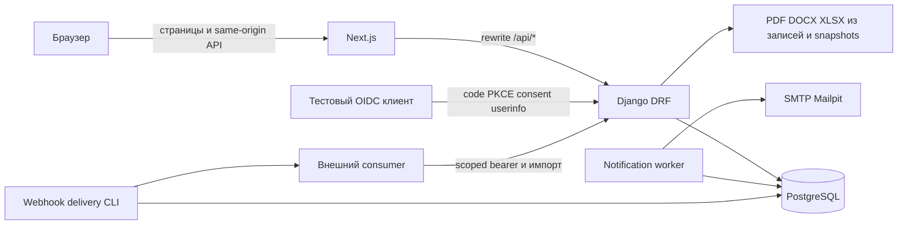

# Фактическая архитектура

Runtime-код `0c43b00`, объединённая ветка `codex/integrate-optional-d1-d12`.
Это описание реализации, не утверждение о полном выполнении ТЗ.
[Текущие ограничения](CURRENT_STATUS.md), [API](../openapi.yaml).

## Ответственность модулей

- `accounts`: единственный User, назначенные роли/активная сессия, согласия,
  представитель, профиль/РУСАДА, auth/dashboard и demo seed.
- `catalogs`: дисциплины и организации.
- `competitions`: события/этапы/планы/типы/возраст, заявки, связи тренера,
  судейские назначения, результаты, шаблоны, публикации, история и аудит.
- `qualifications`: заявки на разряд/категорию, решения, сроки, история,
  исправления и настраиваемые предварительные правила.
- `ratings`: версии правил, вклад опубликованных результатов, коэффициенты,
  расчёты и ограничения спортсменов.
- `teams`: ручной выбор/порядок, составы, публикация и документы.
- `registry`: реестры, исторические периоды, корректировки,
  calendar-year-v1 численность и XLSX/fingerprint.
- `notifications`: основной inbox/outbox, планирование сроков, SMTP/retry.
- `extensions`: Д1–Д12, дополнительный inbox, OIDC/OAuth Toolkit,
  scoped integrations, training/assessment/reviews/development/awards/documents.

Next.js предоставляет кабинеты и формы; скрытие кнопки не является защитой.
Backend проверяет активную назначенную роль, объект, согласие и допустимость
изменения. Наблюдатель министерства использует отдельное read-only permission
на существующем User; новой спортивной роли для него нет.

## Источники данных

Опубликованная версия протокола — источник истории, рейтинга и основания
заявления на разряд. Корректировка создаёт новую публикацию; старый snapshot
не переписывается. Сборная выбирается федерацией вручную.

Основной отчёт численности читает ParticipationPeriod и историю принадлежности,
не восстанавливает неизвестное прошлое из текущего профиля.
TrainingMembership Д3 — другой источник; его зачисления **не обновляют**
основной отчёт автоматически. Д6 показывает оба контура раздельно, Д9 читает
общий registry-report. [Методика](../participation-methodology.md).

Один постоянный `process_notifications --loop` обслуживает основной и
дополнительный outbox и optional-напоминания. `deliver_webhooks` запускается
отдельно. SMTP-приём Mailpit не является подтверждением production receipt.

## Контракты и границы

[OpenAPI](../openapi.yaml), [API_CONTRACTS](API_CONTRACTS.md),
[AUTH_AND_PERMISSIONS](AUTH_AND_PERMISSIONS.md), [внешние API/OIDC](../optional-integrations.md).
Session/CSRF, интеграционный bearer и OIDC-токены имеют разные области применения.

ЕВСК-подсказки не настроены; Д4/Д7/Д8 используют демонстрационные правила.
Шаблоны документов не приняты по заданным формам. Ключи OIDC и интеграций
вне исходников, фиктивные данные — только в локальном demo-окружении.

Визуальный контракт — неизменённый [fsp-reference.html](../design/fsp-reference.html),
его extracted globals.css и дополнительные функциональные стили app.css.
Реальная проверка: [visual QA](../design/visual-qa.md).
