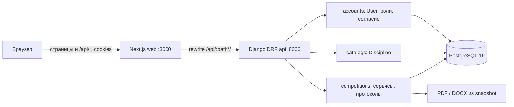

# Фактическая архитектура

Срез кода: `600562d`. Источники: `backend/config`, три приложения в `backend/apps`, `frontend/src`, `docker-compose.yml`, [OpenAPI](../openapi.yaml). Master Prompt описывает более широкий продукт; в этой схеме показано только существующее.



`frontend/next.config.ts` перенаправляет `/api/:path*/` на `API_INTERNAL_URL` (`http://api:8000` в Compose). Клиент `frontend/src/lib/api.ts` всегда посылает cookies, перед небезопасным запросом получает CSRF token. Django использует `SessionAuthentication`; `active_role` лежит в серверной сессии и сверяется с назначениями `UserRole`. `AppShell` хранит в `localStorage` только выбор темы, не учётные данные. PostgreSQL — рабочее хранилище Compose; SQLite включается явно через `DATABASE_ENGINE=sqlite` для локальной проверки.

## Владение правилами

| Правило | Исполняющий слой |
| --- | --- |
| Учётная запись, согласие, несовершеннолетний при регистрации | `apps/accounts/serializers.py`, транзакция `RegisterSerializer.create` |
| Наличие активной назначенной роли | `accounts/views.py` для dashboard/переключения; `competitions/services.py:require_role` для доменных API |
| Видимость черновика и списков по объекту | `competitions/views.py` — выборки по пользователю, назначению и состоянию |
| Возраст, срок, согласие, подтверждённая связь тренера | `competitions/services.py:check_application_eligibility` |
| Даты, шаблон и состав этапов соревнования | `competitions/serializers.py:CompetitionSerializer.validate` |
| Метрики результата и протокола | `competitions/services.py:validate_result_data`, `validate_template_definition` |
| Снимок и версия протокола | `competitions/services.py:protocol_snapshot`, `publish_protocol` |
| PDF/DOCX | `competitions/exporters.py` из сохранённого `ProtocolPublication.snapshot` |
| Отображение, форма, тема, responsive | `frontend/src/app`, `frontend/src/components`, CSS; сервер повторно проверяет данные |

## Поток соревнования

```mermaid
sequenceDiagram
  participant F as Федерация UI
  participant A as DRF views
  participant S as competitions/services
  participant D as PostgreSQL
  participant U as Спортсмен UI
  F->>A: POST competitions/ и publish/
  A->>D: Competition draft -> published + AuditEvent
  U->>A: POST applications/
  A->>S: check_application_eligibility
  S->>D: роль, возраст, согласие, связь, дубликат
  A->>D: Application pending
  F->>A: POST applications/{id}/decision/
  A->>D: approved/rejected + AuditEvent
  F->>A: POST judge-assignments/; results/validate/
  A->>D: назначение, проверенный Result
  F->>A: GET protocol-preview/; POST protocol-publish/
  A->>S: publish_protocol (atomic, row locks)
  S->>D: неизменяемый snapshot + версия + AuditEvent
  U->>A: GET history/
  A->>D: только своя строка последней версии
```

Создание/редактирование соревнования, решение по заявке, ввод/валидация результата, создание шаблона и публикация протокола оставляют `AuditEvent` там, где его вызывает код. Публикация блокирует строки соревнования, заявок и результатов в одной транзакции и повторно проверяет согласия. Снимок включает каждого **одобренного** участника; при отсутствии результата ставится `pending_result`, без балла и места. Исправление создаёт следующую версию с обязательной причиной. История спортсмена читает последнюю версию и только его строку. Отдельного публичного API протоколов нет.

## Состояние границ

Phase 1: сессии, роли, consent, шесть дисциплин, четыре ролевые сводки и визуальная оболочка. Phase 2: календарь, заявки, модерация, связь тренера, судьи, результаты, шаблоны, протокол, PDF/DOCX, личная история. `Competition.State.CLOSED` объявлен, но отдельного маршрута закрытия сейчас нет. Phase 3 **не начата**: спортивные разряды, судейские категории, рейтинг, сборная, двухлетняя аналитика, уведомления и XLSX отсутствуют. Смотрите [CURRENT_STATUS.md](CURRENT_STATUS.md), [BACKEND_GUIDE.md](BACKEND_GUIDE.md) и [AUTH_AND_PERMISSIONS.md](AUTH_AND_PERMISSIONS.md).
